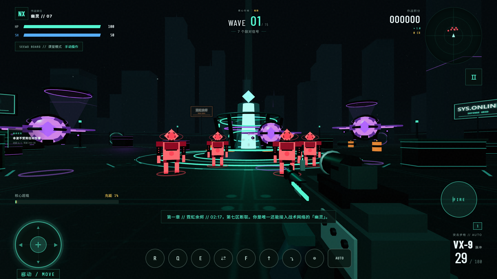

# NEXUS STRIKE // 零界突击 1.0 正式版

> 一款完全跑在浏览器里的赛博科技风 3D 第一人称射击游戏。零外部模型、零外部音频 —— 场景、枪械、敌人、特效全部程序化生成，克隆下来双击就能玩。**电脑、手机、希沃白板大屏三端通吃。**


| 战斗画面 | 手机触屏 | 希沃白板大屏 |
| --- | --- | --- |
|  |  |  |

## 在线试玩 / 快速开始

**方式一：在线直接玩（推荐）**

游戏已通过 GitHub Pages 发布，打开即玩，手机也可以：
**https://zouzhenghao.github.io/game/**

**方式二：单文件离线版**

下载仓库中的 [`nexus-strike-standalone.html`](nexus-strike-standalone.html)（整个游戏打包在一个 HTML 文件里），双击用 Chrome / Edge 打开即可，无需安装任何东西、无需联网、无需服务器。

**方式三：本地开发运行**

```bash
npm install     # 安装依赖（仅 three.js 与 vite）
npm run dev     # 启动开发服务器，浏览器打开提示的地址
```

Windows 用户也可以直接双击 **`START-GAME.bat`**：自动检查 Node.js、首次自动装依赖、启动游戏并打开浏览器。

> ⚠️ 不要直接双击根目录的 `index.html` —— 那是 Vite 源码入口（引用 `/src/main.js`），必须经开发服务器或构建后才能在浏览器运行。

## 这是一款什么游戏

2149 年，霓虹之城第七区的战术网络在凌晨 02:17 被不明机械军团入侵。你是最后一名仍能接入神经链接的「幽灵」作战员。突入数据废墟，在一波波围剿中活下来，最终摧毁「守望者」核心。

核心循环是 **波次生存 + 商店构筑 + 肉鸽成长**：开局从三类枪械中选定起始武器；每清除一波，先在「战后补给站」用信用点购买武器与补给，再从三个随机战术模块中挑一个，逐波把初始装备滚成完全不同的战斗流派。每波还有随机战术任务与章节剧情，第 3 / 6 / 9 波出现流动商人。难度决定通关波数，通关基础 10 波后解锁极限难度、军需官与战场事件。

---

## 1.0 正式版更新

### 一、既有问题修复（优先处理用户体验）

| 问题 | 修复 |
| --- | --- |
| **火箭发射崩溃** | `fireWeapon` 的火箭分支在 `baseDirection` 声明之前引用它（TDZ），一开火就抛 `ReferenceError`。现已在函数开头统一求出射线原点与方向 |
| **外挂锁不到 / 打不中** | 新增统一瞄点 `getAimPoint()`：所有敌人（地面 / 悬浮 / 固定炮台 / 首领）都取**头部弱点网格的世界坐标**，即射线真正会命中的那块网格，瞄头线与命中判定完全一致；出生动画中的单位也可被锁定；锁头与开火同帧同步相机，不再慢一帧 |
| **自动瞄准乱跳** | `pickCheatTarget` 改为**按距离由近到远排序** + 视线过滤 + 目标粘滞（当前目标未被明显更近者取代就不切换）；演示模式与触屏辅助瞄准也复用同一套规则 |
| **子弹打不中** | 加入 **宽容命中**：射线擦身而过时按统一瞄点做球形补偿，连续 4 发落空后窗口再放宽一次；半自动武器在自动射击下也能连发 |
| **透视穿墙异常** | 血条原本 `depthTest:false`，不开透视也一直穿墙。现改为默认受深度遮挡，**仅 X-RAY 开启时**才把敌人本体与血条切为穿墙显示 |
| **子弹 / 爆炸穿墙** | 明确墙体规则（见下），所有 AoE（导弹、油桶、脉冲、冲刺波、电弧）与敌方弹丸共用同一套遮挡判定；高速弹丸增加线段防隧穿检测 |
| **油桶爆炸不消失** | `explodeBarrel` 改用 `removeFromParent()`（油桶挂在 `world` 下而非 `scene` 下） |
| **白板找不到摇杆** | `.touch-stick` 的 `position:absolute` 原本只写在 `@media(pointer:coarse)` 里，希沃一体机常上报 `pointer:fine` 导致摇杆掉进文档流。现于 board 档显式补齐定位，并加高对比双环、中心十字、四向箭头、常显「移动 / MOVE」标签与入场提示 |

**明确的墙体规则**：只有**实体掩体（含顶盖）、中央核心基座、竞技场围墙、未爆油桶**阻挡子弹、爆炸、锁头视线与敌方弹丸；地面、灯柱、广告牌、悬浮平台、远景城市与发光装饰一律不参与遮挡判定。玩家、敌人、弹道、AoE、透视与自动瞄准共用这套规则。

### 二、表现与手感优化

- **模型细化**：全枪系加装**带红点的全息瞄准镜**（镜筒 / 镜片 / 红点 / 调节旋钮），第一人称补上手臂与护手，每把新增武器有独立配色与专属外形（手枪 / 模块化步枪 / 反器材狙击）；敌人补脚下能量环与头顶缓旋装甲环。
- **完整动作**：走（摆动 + 头部起伏）、跑（疾跑加速 + 武器下沉 + FOV 拉伸）、**跳**（Space，落地缓冲）、**滑铲**（Ctrl / C，锁定方向加速 + 压低视角 + 武器自然倾斜）、**瞄准过渡**（平滑 blends，武器收敛到视线中心、红点亮起、FOV 收窄）。跳跃与滑铲不影响 `player.position.y`，敌方瞄准基准保持稳定。
- **绝区零式战斗反馈**：命中后敌人**头顶弹出连续命中数**、命中顿帧 hitstop、暴击伤害数字放大变色、轻微震屏、命中火花；子弹保留散布偏移，配合宽容命中让手感更跟手。
- **机动性**：疾跑 / 冲刺 / 跳跃 / 滑铲可衔接，跑步与滑铲期间武器姿态自然过渡。

### 三、内容扩充

- **15 把武器**，按 `手枪 / 步枪 / 狙击枪 / 特殊` 四类编组；其中手枪、步枪、狙击**各新增 3 把**（PX-1/2/3、AR-4/8/9、SR-2/6/9），军械库分类展示伤害、射速、弹匣与价格。
- **开局可选武器**：首页「起始武器」三选一（PX-1 手枪 / VX-9 步枪 / SR-2 狙击）。
- **战后补给站 + 肉鸽**：首波结束即开放；每波结算发放信用点，货架随机 3 件未持有武器 + 修复包 / 弹药箱，购买后即时加入 loadout；随后照常三选一战术模块。按 `1–6` 切换已持有武器，滚轮 / `⇄` 循环切换。
- **新模式「限时歼灭」**：每波倒计时，击毁敌人续时，超时即失败，积分与节奏更紧凑。
- **难度绑定波次**：新兵 **10 波** / 标准 **15 波** / 噩梦 **20 波** / 极限 **25 波**；极限难度通关后解锁，无尽模式每 5 波继续增压。
- **任务系统与故事线**：每波随机战术任务（无伤、暴击、弱点命中、连击、油桶击杀、击毁数），完成发放信用点；六个章节剧情按波次推送，HUD 常显任务进度。
- **NPC 商人**：第 3 / 6 / 9 波投放 3D 悬浮商人，靠近显示交互提示，按 `G` 打开战场补给站。
- **通关解锁**：通关 ≥10 波后永久解锁「极限」难度、军需官精英补给与波次间随机战场事件（补给空投 / 情报官 / 工程师折扣 / 精英增援）。

### 四、1.0 发布

版本号统一为 `BUILD 1.0.0`，文档、简报、操作指南、作弊清单与线上页面全部同步；生产构建、四端实机回归、GitHub Pages 与单文件离线版一并更新。

---

## 模式与难度

| 模式 | 说明 |
| --- | --- |
| **核心行动** | 章节战役，按难度打到最终波迎战守望者 |
| **无尽裂隙** | 无限增压，每 5 波首领，用于刷纪录 |
| **限时歼灭** | 每波倒计时，击杀续时，超时失败 |
| **模拟训练** | 敌方伤害关闭，熟悉武器与动作 |

| 难度 | 通关波数 | 敌人血量 / 伤害 | 解锁条件 |
| --- | --- | --- | --- |
| 新兵 | 10 | 0.78 / 0.68 | 默认 |
| 标准 | 15 | 1.0 / 1.0 | 默认 |
| 噩梦 | 20 | 1.4 / 1.45 | 默认 |
| 极限 | 25 | 1.85 / 1.8 | 通关任意 ≥10 波战役 |

## 完整内容一览

- **15 把武器**：手枪 3（PX-1 哨兵 / PX-2 双生 / PX-3 审判）、步枪 5（VX-9 脉冲 / LN-3 寒霜 / AR-4 破晓 / AR-8 蜂刺 / AR-9 重锤）、狙击 4（R-01 磁轨 / SR-2 静默 / SR-6 穿云 / SR-9 天罚）、特殊 3（SG-12 裂解 / ARC-7 弧光 / WN-5 蜂巢）
- **九类敌人**：猎犬突击体、蜂群射手、重装碾压者、相位幽影、自毁蜂群、维生单元、定点炮台、游隼突袭者、守望者核心
- **战斗系统**：统一瞄点与宽容命中、暴击与弱点、伤害飘字与头顶连击数、顿帧、装填与弹药、生命 / 护盾双层防御、连击倍率积分、制导导弹与 AoE、链式电弧、寒霜减速
- **战术技能**：相位冲刺（无敌帧）、电磁脉冲、核心超载、疾跑、跳跃、滑铲、精确瞄准
- **成长系统**：17 种战术模块三选一、信用点商店、波次配发武器、生命 / 护盾 / 弹药掉落、难度倍率、通关解锁
- **任务与剧情**：6 类随机战术任务、6 章故事线、流动商人、通关后随机战场事件
- **完整流程**：科技风首页、作战简报 / 武器库 / 操作指南 / 生涯档案、波次播报、击杀信息流、雷达、暂停、胜负结算、本地最高纪录
- **三端适配**：桌面键鼠 + 手机双摇杆触控 + 希沃白板大屏触控，竖屏可玩，自动降采样与辅助瞄准

## 操作说明

**桌面端**

| 按键 | 功能 |
| --- | --- |
| `W A S D` | 移动 |
| 鼠标 / 左键 / 右键 | 观察 / 射击 / 精确瞄准（红点） |
| `Shift` | 疾跑（武器下沉） |
| `Space` | 跳跃 |
| `Ctrl / C` | 滑铲 |
| `Q / E` | 相位冲刺 / 电磁脉冲 |
| `F` | 核心超载（能量满时） |
| `G` | 靠近 NPC 商人时交易 |
| `R / 1–6` | 装填 / 切换已持有武器 |
| `Esc / P` | 暂停 |

**手机端**：左下摇杆移动，右侧滑动转向，`FIRE` 按住射击，`R` 装填，`Q` 冲刺，`E` 脉冲，`F` 超载，`↑` 跳跃，`⤵` 滑铲，`⇄` 切换武器，右上角暂停。自动辅助瞄准近距离目标。

**希沃白板 / 大屏触控**：左下角高对比「移动 / MOVE」圆形摇杆（含方向箭头与中心十字），右侧滑动转向，右下 `FIRE` 开火，底部技能排含跳跃 / 滑铲 / 冲刺 / 脉冲 / 超载 / 切枪 / 瞄准 / 演示。全部按钮 ≥64px，弹药打空自动装填，`AUTO` 开启课堂演示（自动锁敌开火）。

## 作弊码 // 越界协议 OVERBOUND

单机训练彩蛋。进入对局后直接敲字母触发（大小写均可，需连续输入整词），或按 **`** 反引号 / **↑↑↓↓←→←→BA** 展开清单。同一密语再敲一次即关闭。

| 密语 | 效果 |
| --- | --- |
| `LOCKON` | 锁头：按距离近→远选靶，统一瞄头线，跳过墙后目标 |
| `AUTOFIRE` | 自动射击：锁定后持续开火（含半自动武器） |
| `GODMODE` | 无敌 |
| `INFINITY` | 无限弹药 |
| `XRAY` | 透视：仅开启时敌人才穿墙显示 |
| `TIMESLIP` | 子弹时间：敌人与弹体减速 60% |
| `PURGE` | 清场：秒杀当前全部敌人 |
| `ARSENAL` | 解锁全部 15 把武器 |
| `RECHARGE` | 生命 / 护盾 / 能量 / 弹药全满 |
| `OVERBOUND` / `STANDDOWN` | 协议全开 / 全关 |

## 技术实现

- **Vite + Three.js（ES Modules）**，无游戏引擎框架
- 全部模型（枪械、敌人、首领、场景建筑、城市天际线）由 Three.js 几何体程序化构建，**仓库里没有一个二进制模型资源**
- 音效全部由 Web Audio API 实时合成
- 三态设备识别 + 独立 Raycaster 用于开火 / 视线遮挡判定；hitstop 通过缩放世界 dt 实现
- 战绩、通关进度、成就与音效偏好保存在 `localStorage`，不上传任何数据

```
├── index.html                  # 页面结构（菜单 / HUD / 商店 / 结算 / 触控层）
├── vite.config.js              # 相对 base 配置（兼容 GitHub Pages 与本地）
├── src/
│   ├── main.js                 # 入口，界面状态与 HUD 绑定、设备识别
│   ├── style.css               # 科技风视觉系统
│   ├── board.css               # 希沃白板大屏专属样式
│   └── game/
│       ├── Game.js             # 核心：15 把武器、9 类敌人、波次、商店、任务、NPC、作弊系统
│       ├── Models.js           # 程序化枪械（含红点镜）/ 敌人 / 首领模型
│       ├── World.js            # 程序化战场与遮挡体
│       └── Audio.js            # Web Audio 程序化音效
├── nexus-strike-standalone.html  # 单文件离线版（构建产物内联）
├── docs/                       # GitHub Pages 在线版
├── screenshots/                # 展示截图
└── START-GAME.bat              # Windows 一键启动
```

## 1.0 实机验证

- 桌面（1280×800 / 1440×900）、手机竖屏（390×844）、希沃白板（1920×1080 触控）、4K 大屏（3840×2160）真实 Chrome 运行，控制台零报错
- 修复项：火箭分支不再抛错、锁头按距离排序 + 粘滞、自动射击实际造成伤害、宽容命中生效、墙体遮挡与视线一致、透视仅开启时穿墙、油桶爆炸后移除、白板摇杆在 `pointer:fine` 下仍可见
- 手感项：跳跃顶点 1.14m / 落地归零、滑铲压低视角并下沉武器、疾跑与瞄准过渡 blends、红点随瞄准亮起、命中顿帧、头顶连击数
- 内容项：15 把武器模型全部可构建、起始选枪生效、商店 5 件货架 / 购买 / 扣款 / 解锁、数字键槽位映射、军械库 4 类 15 张卡、四档难度 10/15/20/25 波、限时歼灭倒计时与击杀续时、任务完成、NPC 商人交互、通关解锁
- 白板摇杆在 `?device=board` + 无 coarse pointer 环境下 `position:absolute`、尺寸 180px、4 个方向箭头与常显标签均通过校验
- `npm run build` 生产构建通过；单文件离线版在 `file://` 下可直接运行

---

*纯前端实现 · 无需服务器 · 所有数据保存在本地浏览器中*
