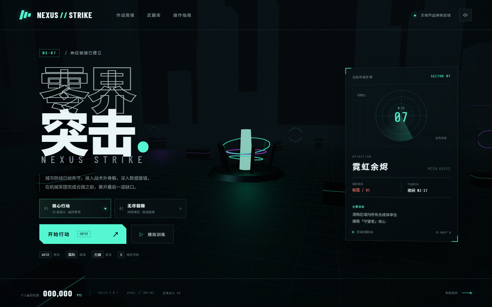
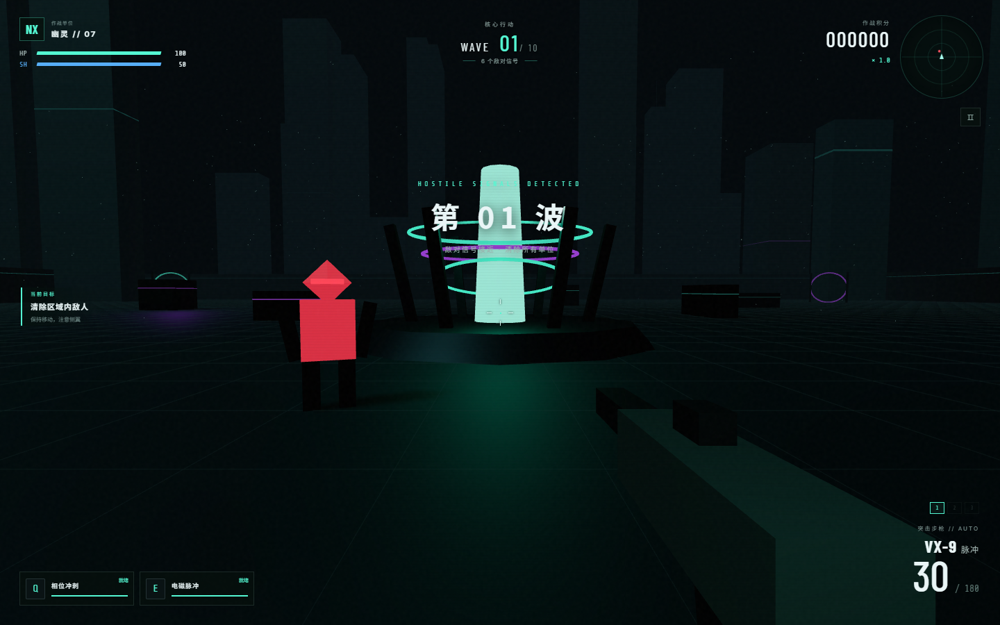
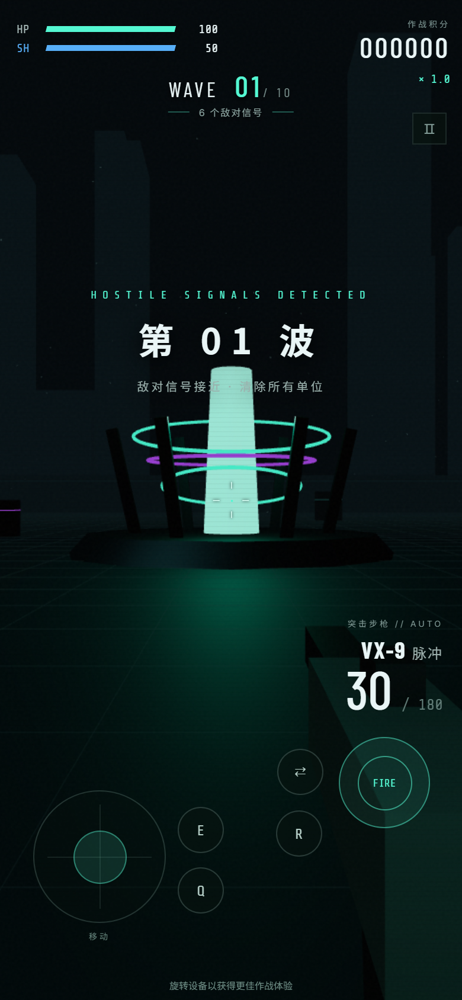

# NEXUS STRIKE // 零界突击

> 一款完全跑在浏览器里的赛博科技风 3D 第一人称射击游戏。零外部模型、零外部音频 —— 场景、枪械、敌人全部程序化生成，克隆下来双击就能玩。



| 战斗画面 | 手机触屏 |
| --- | --- |
|  |  |

## 在线试玩 / 快速开始

**方式一：在线直接玩（推荐）**

游戏已通过 GitHub Pages 发布，打开即玩：
**https://zouzhenghao.github.io/game/**

**方式二：单文件离线版**

下载仓库中的 [`nexus-strike-standalone.html`](nexus-strike-standalone.html)（约 570 KB，整个游戏打包在一个 HTML 文件里），双击用 Chrome / Edge 打开即可，无需安装任何东西。

**方式三：本地开发运行**

```bash
npm install     # 安装依赖（仅 three.js 与 vite）
npm run dev     # 启动开发服务器，浏览器打开提示的地址
```

Windows 用户也可以直接双击 **`START-GAME.bat`**：自动检查 Node.js、首次自动装依赖、启动游戏并打开浏览器。

## 这是一款什么游戏

2149 年，霓虹之城的数据废墟中，机械军团正在围合。你操纵外骨骼突入战区，在 10 波进攻中存活，摧毁守望者核心。

- **三种作战模式**
  - `核心行动`：10 波敌潮 + 最终首领「守望者核心」的完整战役
  - `无尽裂隙`：波次无限、难度持续攀升，冲击最高纪录
  - `模拟训练`：无伤害环境，熟悉三种武器与技能循环
- **三种武器**
  - `VX-9 脉冲`：全自动突击步枪，稳定的输出主力
  - `SG-12 裂解`：战术霰弹枪，8 弹丸近距离毁灭性伤害
  - `R-01 磁轨`：半自动精确步枪，可贯穿多个敌人的 135 点高伤
- **四类敌人**
  - `猎犬突击体`：高速近战冲锋单位
  - `蜂群射手`：悬浮射击的无人机群
  - `重装碾压者`：高血量重甲推进单位
  - `守望者核心`：最终首领，携带专属血条 HUD
- **战斗系统**：射线检测命中、暴击、装填与弹药管理、生命与护盾双层防御、连击倍率积分
- **战术技能**：相位冲刺（位移无敌帧）、电磁脉冲（范围伤害）、疾跑、精确瞄准（右键）
- **成长系统**：每波结束三选一强化（伤害 / 射速 / 弹药 / 生命 / 护盾……）、波次推进解锁武器、敌人掉落补给
- **完整体验**：科技风首页与作战简报 / 武器库 / 操作指南、波次播报、击杀信息流、雷达、胜负结算、本地最高纪录
- **双端适配**：桌面键鼠 + 手机端双摇杆触控与辅助瞄准，竖屏可玩

## 操作说明

**桌面端**

| 按键 | 功能 |
| --- | --- |
| `W A S D` | 移动 |
| 鼠标 | 瞄准 / 左键射击 |
| 右键 | 精确瞄准 |
| `Shift` | 疾跑 |
| `Q` | 相位冲刺 |
| `E` | 电磁脉冲 |
| `R` | 装填 |
| `1 / 2 / 3` | 切换武器 |
| `Esc / P` | 暂停 |

**移动端**：左侧摇杆移动，右侧区域滑动转向，`FIRE` 射击，`R` 装填，`Q` 冲刺，`E` 脉冲，右上角切换武器。

## 技术实现

- **Vite + Three.js（ES Modules）**，无任何游戏引擎框架
- 全部模型（枪械、敌人、首领、场景建筑、能量核心）由 Three.js 几何体程序化构建，**仓库里没有一个二进制资源文件**
- 音效全部由 Web Audio API 实时合成（射击、命中、装填、爆炸、UI 反馈）
- 手机端自动检测触屏并启用双摇杆 + 辅助瞄准 + 降采样渲染

```
├── index.html                  # 页面结构（菜单 / HUD / 结算 / 触控层）
├── src/
│   ├── main.js                 # 入口，初始化游戏实例
│   ├── style.css               # 科技风视觉系统
│   └── game/
│       ├── Game.js             # 核心：场景、武器、敌人 AI、波次、技能、升级
│       └── Audio.js            # Web Audio 程序化音效
├── nexus-strike-standalone.html  # 单文件离线版（构建产物内联）
├── docs/                       # GitHub Pages 在线版
├── screenshots/                # 展示截图
└── START-GAME.bat              # Windows 一键启动
```

## 已验证内容

- 桌面端与移动端真实浏览器运行，控制台零报错
- 射击命中、伤害结算、弹药消耗、击杀与掉落、技能冷却、武器切换、三选一升级、暂停与结算全流程通过断言测试
- 完整模拟 10 波战役：最终首领被摧毁后正常进入「黎明已至」胜利结算
- 单文件版在 `file://` 协议下可直接运行（无跨域依赖）

---

*纯前端实现 · 无需服务器 · 所有数据保存在本地浏览器中*
